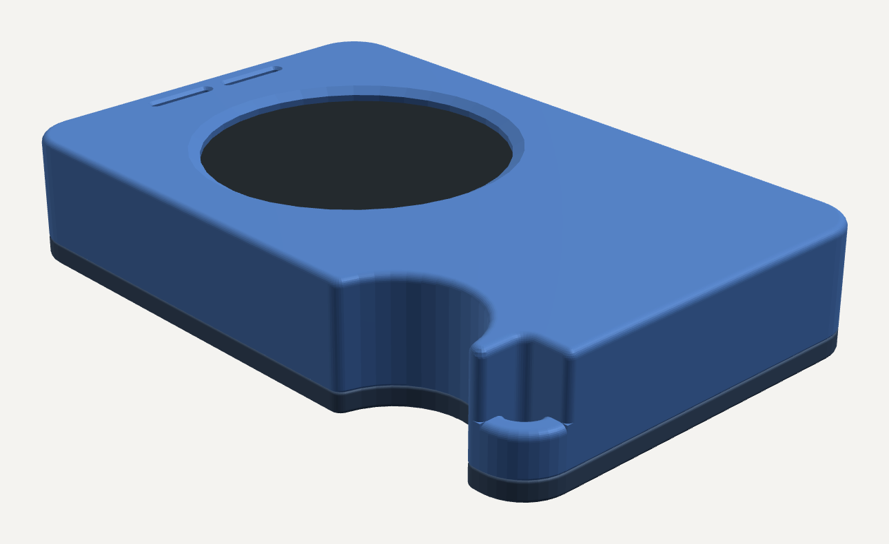
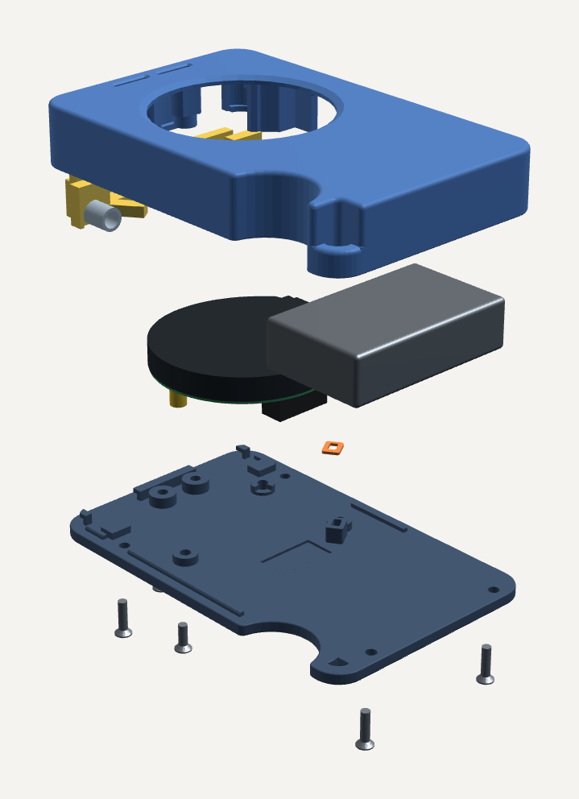

# Muse Gadget case for the Waveshare ESP32-S3-Touch-LCD-1.46B

A resin-printed, credit-card-sized case for a **Muse Gadget** (the device you build with Meta's
open-source [Muse Gadget SDK](https://github.com/facebookincubator/muse-gadget-sdk)) running on the
**Waveshare ESP32-S3-Touch-LCD-1.46B**: the 1.46" round 412 x 412 touch display board with the
ESP32-S3, onboard speaker and microphone, microSD slot, and PWR / BOOT buttons.

The case is built around the 1.46B's own geometry, with every board feature placed from
Waveshare's drawing and 3D model:
- the three brass standoffs;
- the PWR and BOOT switches;
- the USB-C port;
- the MEMS microphone on the back of the PCB;
- the speaker;
- the header and the microSD slot.

| | |
|---|---|
| Size | 54 x 85.5 x 15.8 mm (a bank-card footprint) |
| Parts | front case, back plate, 2 trigger levers (+ an optional fit gauge) |
| Print | resin (MSLA), tough / ABS-like |
| Fasteners | 9 x M2 countersunk screws from the back, into printed M2 x 0.4 threads and the board's standoffs |

## Features

- **Round window** for the 1.46" display, with the glass seated 0.3 mm behind a 1.6 mm lip.
- **Two trigger levers** on the top edge press the board's PWR and BOOT switches. Each one pivots
  on a printed spigot, is spring-returned, and has an over-travel stop so it can't crush the switch.
- **USB-C** opening on the right edge, sized for a typical plug overmold.
- **Speaker grille**: two flared slots in the face over the onboard speaker.
- **Microphone port** through the back plate, under the 1.46B's mic (MSM261S4030H0R, on the back of
  the PCB). A collar and a foam gasket seal it to the mic.
- **Battery bay** for a pouch cell up to 41 x 25 x 11 mm beside the board, with a lead notch.
  There is room for a microSD card in its slot.
- **Slide-and-hook back plate.** The plate drops in 1.3 mm short of the top edge and slides up
  under three hooks, so the button edge can't lift. Four screws and two pivot screws do the rest,
  and an alignment lip locates it.
- **Printed M2 x 0.4 threads** in all six case screw posts, for plain machine screws.
- **Finger grip** scoop on the left edge, and a PSP-style **open corner loop** for a keyring or
  lanyard (2.36 mm slot).
- Every edge round runs continuously around the case. No fillets stop halfway.

## Bill of materials

| Qty | Part | Notes |
|---|---|---|
| 1 | **Waveshare ESP32-S3-Touch-LCD-1.46B** | With its three M2 brass standoffs on the back of the PCB (3.55 mm tall, PCB back to standoff top, per Waveshare's drawing). The case does not fit other 1.46" boards. |
| 1 | LiPo pouch cell, **max 41 x 25 x 11 mm** | 3.7 V, with a lead and connector to match the board's battery header (check the Waveshare wiki for the connector type). The lead must leave the cell where it can reach the divider notch, not from the left end. |
| 3 | **M2 x 6** countersunk screw (ISO 7046 / DIN 965) | Into the board's brass standoffs. |
| 6 | **M2 x 8** countersunk screw (ISO 7046 / DIN 965) | 4 into the case posts, 2 into the trigger pivots (printed threads). |
| 2 | Compression spring, **OD 5.0 mm, ID >= 3.3 mm, free length ~8 mm**, wire ~0.5 mm | Return springs for the two triggers (about 6.5 mm installed, around 1 N/mm). Common in spring assortment kits. |
| 1 | Mic gasket (**optional, recommended**): either print `stl/tpu_mic_gasket.stl` in TPU 95A, or use **1.0 mm** adhesive-backed closed-cell foam | For foam, cut a ring **3.8 x 4.8 mm outside, 1.8 x 2.8 mm inside**. See [The microphone gasket](#the-microphone-gasket). |
| ~60-70 ml | Tough / ABS-like resin | The parts are about 27 cm3; the rest is supports. |
| 1 | USB-C cable | The opening is 12.8 x 7.4 mm, so very wide overmolds won't fit. |
| opt. | M2 x 0.4 tap | Only to clean a printed thread if a screw binds. |
| opt. | microSD card, keyring or lanyard | |

## Files

| File | What |
|---|---|
| `stl/front_case.stl` | Main case (window, trigger bays, battery bay, threaded posts). Exported screen-face down. |
| `stl/back_plate.stl` | Back plate (hooks, lip, mic collar, countersunk screw holes). Exported outer face down. |
| `stl/trigger_pwr.stl`, `stl/trigger_boot.stl` | The two trigger levers. They are mirror pairs, not interchangeable. |
| `stl/tpu_mic_gasket.stl` | Optional microphone gasket, to print in **TPU** (FDM). 3.8 x 4.8 x 0.75 mm. See below. |
| `stl/fit_gauge_display_pocket.stl` | **Print this first**: the display end of the front case, full height. The board must drop in under its own weight and lift out without prying. |

The STLs are in millimetres. Each part is one watertight body.

## Printing (resin)

1. **Print the fit gauge first** and check the board drops in. Resin shrinkage varies by printer
   and resin, so this tells you before you spend 60 ml.
2. **Re-orient in your slicer.** The STLs are laid flat. Tilt the front case about 30-45 deg with
   the **screen face up, away from the plate**, so the cavity faces the plate. That way no supports
   touch the visible face and the open tub doesn't form a suction cup. Tilt the back plate the same
   way, outer face up.
3. Never put supports on the screen lip or the screen face.
4. Tough / ABS-like resin, washed and **fully post-cured before you drive any screws**.

## The microphone gasket

The 1.46B's microphone is top-ported and faces the back plate. The case's mic port is a 1 mm hole
in the back plate under a raised collar, with a **0.6 mm gap** between the collar top and the mic.

**Is it needed?** Not for the mic to work. Without it, though, that gap is open all around the
collar edge, about 9 mm2 into the case interior against the port's 0.8 mm2. The mic then mostly
hears the air inside the case, which also holds the unsealed onboard speaker. Expect duller voice
pickup and more speaker-to-mic echo. For a voice gadget, fit the gasket; if you skip it, test your
wake word and echo first. (This is from the geometry, not a measured comparison.)

**TPU version (`stl/tpu_mic_gasket.stl`).** A flat TPU ring the size of the collar would be far too
stiff: squeezed 0.15 mm it would press about 70 N into the PCB at the mic. So the printed gasket is a
**lip seal**:
- a 0.2 mm base glued to the collar;
- a 0.45 mm wall round the port that leans inward and **flexes** against the mic lid, about 5 N at
  its 0.15 mm design squeeze;
- its tip lands only on the mic's 3 x 4 mm lid, around the port.

It is checked against the real collar and mic: it stays on the collar, the lip lands on the lid
(a lip that doesn't lean fails that check), and it clears the nearest parts by 0.55 mm or more.

Print it in **TPU 95A**:
- 0.4 mm nozzle, **0.1 mm layers**, 100% infill;
- flat on the bed, base down, exactly as exported;
- slow (10-15 mm/s), with a few copies spaced apart so each layer has time to cool.

If a copy comes out much taller than 0.75 mm, use another. Soft foam (1.0 mm closed-cell) works too.

## Assembly

1. Front case face-down on a soft cloth, screen window down.
2. **Triggers onto their spigots**: PWR on the left, BOOT on the right, seen from the front. Then
   drop each spring into its seat; the seats open toward the back, so the springs go in last.
3. **Battery into its bay**, lead through the notch in the divider.
4. **Board in**: display into the window, with the three brass standoffs pointing at you.
5. **Gasket (optional)**: put it on the mic collar on the inside of the back plate. For the TPU
   part, place it **flat base down, lip up** and fix it with a tiny dot of flexible CA or contact
   cement. Foam is self-adhesive.
6. **Back plate on, 1.3 mm short of the top edge.** Lay it flat with its top edge 1.3 mm toward
   the bottom, lower it straight down, then **slide it toward the top edge** until it stops. The
   three hooks run over their ledges. Slide gently, because the gasket rides across the mic.
7. **Screws, bottom first**, so the slide is locked:
   - 2 x M2x8 along the bottom edge;
   - 2 x M2x8 at the top corners;
   - 2 x M2x8 in the trigger pivots;
   - 3 x M2x6 into the board standoffs.

   Start each screw **by hand**: turn it backward until you feel it drop into the printed thread,
   then forward. Stop at snug. If one binds, run an M2 tap through once instead of forcing it.

## Status and what is checked

This is revision **v10s**. It was checked in CAD on the exact solids these STLs come from:
- 418 design checks;
- every part against every other part and every board component (115 pairs, 0 unexpected
  clashes), measured as true minimum gaps;
- the back-plate slide, clear at every position;
- screw engagement and tip clearance for all 9 screws;
- the printed threads (pitch, crest and wall), by point sampling.

Earlier revisions were test-printed. This revision's first print is in progress, so treat it as
**unverified on hardware** until it is.

Not settled from the vendor data:
- **Header pin length** behind the PCB: Waveshare's drawing says 3.5 mm and its 3D model 5.55 mm.
  The back plate has 0.6 mm of relief either way.
- **Where the mic's 0.65 mm sound hole sits** on its lid. It isn't in the datasheet; the gasket
  opening covers the middle of the lid.
- **Gasket squeeze**, which depends on your foam.
- **The speaker** is not sealed to the grille.
- **Thread fidelity** depends on how well your printer resolves the 0.4 mm pitch.

## License

[CC BY-NC-SA 4.0](https://creativecommons.org/licenses/by-nc-sa/4.0/) (full text in `LICENSE`).
You may print it for yourself, share it and remix it with attribution, under the same license.
**Selling prints or remixes is not permitted** without permission.

Not affiliated with or endorsed by Meta or Waveshare. "Muse" and "Waveshare" are named only to
say what this case is for.
